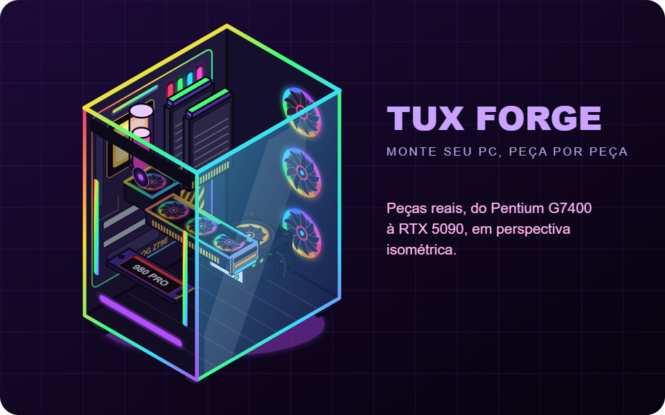
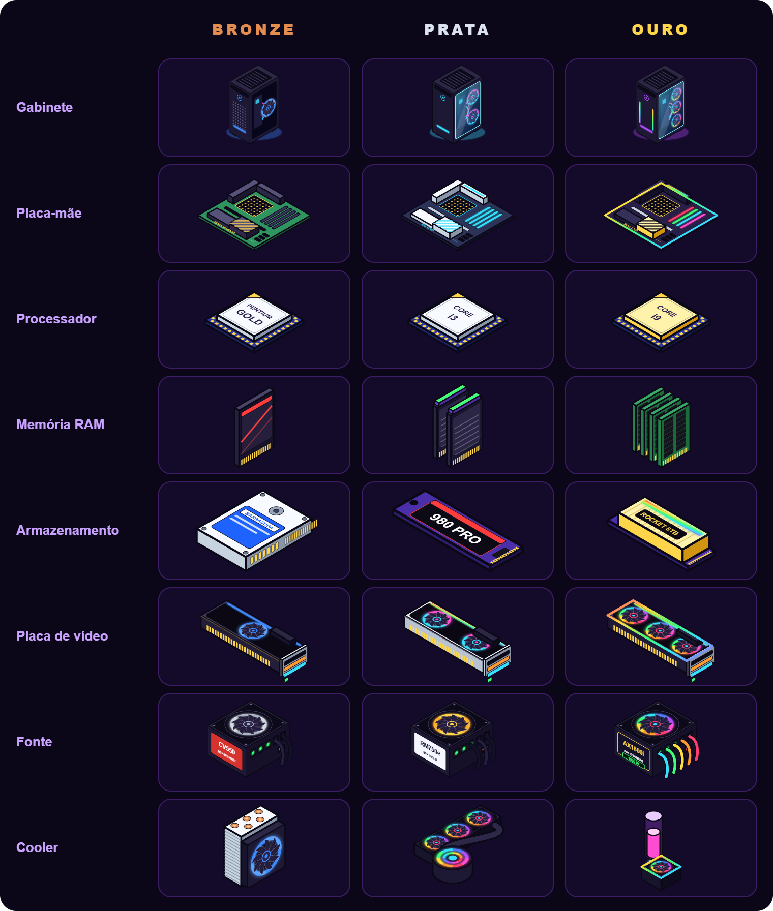

<div align="center">


# TuxForge

**Cruzadinha de Arquitetura Computacional com quiz e montagem de PC.**<br>
Acerte os termos, responda ao quiz e forje o seu computador, peça por peça.

[**▶ Jogar agora**](https://giovann-carneiro.github.io/tuxforge/) &nbsp;·&nbsp; [Como jogar](#como-jogar) &nbsp;·&nbsp; [Palavras e pistas](#palavras-e-pistas) &nbsp;·&nbsp; [Requisitos da atividade](#requisitos-da-atividade)




</div>

---

## Sumário

- [Sobre o projeto](#sobre-o-projeto)
- [Como jogar](#como-jogar)
- [Modos e níveis](#modos-e-níveis)
- [Economia e peças](#economia-e-peças)
- [Títulos do PC](#títulos-do-pc)
- [Extras para continuar jogando](#extras-para-continuar-jogando)
- [Palavras e pistas](#palavras-e-pistas)
- [Requisitos da atividade](#requisitos-da-atividade)
- [Tecnologias e estrutura](#tecnologias-e-estrutura)
- [Executar localmente](#executar-localmente)
- [Créditos e avisos](#créditos-e-avisos)

## Sobre o projeto

O **TuxForge** foi criado para a *Atividade Avaliativa III (Sprint 3)* da disciplina de **Arquitetura Computacional**. O objetivo é treinar os termos da aula (CPU, ULA, UC, registradores, memórias, barramentos, DMA, microcontrolador e núcleos) de um jeito mais divertido do que uma cruzadinha comum.

A ideia: cada palavra descoberta rende **dinheiro**, uma **explicação do termo** e um **quiz**. Com o dinheiro, o jogador compra **peças reais** (de um Pentium G7400 a uma RTX 5090) e monta o próprio computador. Quanto mais rápido e limpo o acerto, mais a palavra paga e melhores são as peças liberadas na loja.

## Como jogar

1. Na tela inicial, escolha o **modo** (Recomendado ou Tudo no difícil) e clique em **Iniciar jogo**.
2. **Digite as letras direto nas casas** da cruzadinha. A pista da palavra selecionada fica destacada na lista à esquerda; clicar numa pista seleciona a palavra.
3. Clique em **✔ Conferir** (ou aperte `Enter`). Palavras certas ficam verdes e travam, as erradas ficam vermelhas, e o contador mostra o progresso, por exemplo *"4 de 6 palavras"*.
4. A cada palavra certa aparece uma **explicação do termo** e, em seguida, um **quiz** de múltipla escolha.
5. Use o dinheiro na **🛒 Loja**, que fica sempre aberta e abre numa janela por cima do jogo (o tempo para enquanto você olha). Você decide quando gastar e quando guardar.
6. Se travar, use **💡 Dica** (revela uma letra e custa dinheiro), **⏭ Pular nível** (responda a uma pergunta bem difícil) ou **⟲ Reiniciar** (limpa o tabuleiro do nível).
7. Ao terminar os 3 níveis, o seu PC recebe um [título](#títulos-do-pc).

**Teclado:** setas movem entre as casas · `Espaço` (ou clicar numa casa de cruzamento) alterna horizontal/vertical · `Tab` vai para a próxima palavra · `Backspace` apaga · `Enter` confere · `Esc` fecha janelas.

**Velocidade vale dinheiro.** O tempo conta desde o seu último acerto e define o nível de acesso às peças:

| Resposta | Medalha | Efeito |
|---|:-:|---|
| Rápida e sem dica | 🥇 Ouro | paga mais e libera as peças Ouro na loja |
| Em tempo médio | 🥈 Prata | libera as peças Prata |
| Lenta, ou com dica | 🥉 Bronze | paga menos; peças Bronze |

O acesso a um nível de peças, uma vez liberado, **fica para sempre**.

## Modos e níveis

- **⭐ Recomendado:** começa fácil e fica mais difícil a cada nível.
- **🔥 Tudo no difícil:** os 3 tabuleiros já com as regras mais duras (sem letras de ajuda, dica de R$ 1.000 e erro de −R$ 800), com recompensas 50% maiores.

| Nível | Dificuldade | Ajuda | Ouro / Prata até | Dica | Erro no Conferir | Pagamento por palavra (Bronze / Prata / Ouro) + quiz |
|---|---|---|---|---|---|---|
| 1 · Power On | Fácil | 1ª letra revelada | 45 s / 100 s | R$ 300 | grátis | R$ 200 / R$ 400 / R$ 600 + R$ 200 |
| 2 · BIOS | Médio | tabuleiro vazio | 40 s / 100 s | R$ 600 | −R$ 400 | R$ 280 / R$ 560 / R$ 840 + R$ 280 |
| 3 · Kernel | Difícil | tabuleiro vazio | 45 s / 110 s | R$ 1.000 | −R$ 800 | R$ 360 / R$ 720 / R$ 1.080 + R$ 360 |

**Pular nível:** a pessoa aceita um desafio e responde a uma pergunta muito difícil. Se acertar, vai para o próximo nível e ganha 30% do valor Prata de cada palavra que faltava. Se errar, espera 60 s para tentar de novo.

## Economia e peças

O dinheiro é limitado de propósito: um PC todo Ouro custa **R$ 29.500**, mais do que dá para ganhar no jogo inteiro, então é preciso **escolher onde gastar**. Ao trocar uma peça, você recebe de volta 50% do preço da antiga. Para comparar: um PC todo Bronze custa R$ 1.750 e um todo Prata, R$ 7.200.

| Encaixe | 🥉 Bronze | 🥈 Prata | 🥇 Ouro |
|---|---|---|---|
| Gabinete | Cooler Master MasterBox Q300L (R$ 150) | NZXT H510 Flow (R$ 600) | Lian Li O11 Dynamic EVO (R$ 2.200) |
| Placa-mãe | ASRock H610M-HDV (R$ 250) | ASUS TUF Gaming B760-Plus WiFi D4 (R$ 900) | ASUS ROG Maximus Z790 Hero (R$ 3.000) |
| Processador | Intel Pentium Gold G7400 (2 núcleos) (R$ 300) | Intel Core i3-12100F (4 núcleos) (R$ 1.000) | Intel Core i9-14900K (24 núcleos) (R$ 4.500) |
| Memória RAM | Kingston Fury Beast 8 GB DDR4 (R$ 150) | Corsair Vengeance RGB 64 GB DDR5 (R$ 900) | Kit RAM 1 TB DDR5 RDIMM (8×128 GB) (R$ 5.500) |
| Armazenamento | Seagate BarraCuda 500 GB (HD) (R$ 150) | Samsung 980 PRO 1 TB (NVMe) (R$ 600) | Sabrent Rocket 4 Plus 8 TB (NVMe) (R$ 2.500) |
| Placa de vídeo | NVIDIA GeForce GTX 1650 4 GB (R$ 500) | AMD Radeon RX 9070 XT 16 GB (R$ 2.200) | NVIDIA GeForce RTX 5090 32 GB (R$ 8.000) |
| Fonte | Corsair CV550 550 W (80 Plus Bronze) (R$ 150) | Corsair RM750e 750 W (80 Plus Gold) (R$ 500) | Corsair AX1600i 1600 W (80 Plus Titanium) (R$ 2.000) |
| Cooler | Cooler Master Hyper 212 (ar) (R$ 100) | Corsair iCUE H150i Elite 360 mm (AIO) (R$ 500) | EK-Quantum Velocity² (loop custom) (R$ 1.800) |

<div align="center">

<br><sub>As 24 peças, desenhadas em código (SVG) em perspectiva isométrica.</sub>
</div>

## Títulos do PC

A soma dos pontos das peças define o título final do computador. Os de baixo vêm com uma frase de zoeira. No jogo, clique no título do seu PC para ver a lista completa e quanto falta para o próximo.

| Título | Pontos | Frase |
|---|---|---|
| 📦 Caixa de papelão | a partir de 0 pts | “Dá para guardar sapato. Computar, nem tanto.” |
| 🍞 Torradeira com Wi-Fi | a partir de 10 pts | “Liga, esquenta, mas só faz torrada.” |
| 🕹️ PC de lan house de 2005 | a partir de 35 pts | “Cheira a salgadinho e roda Counter-Strike no limite.” |
| 🖥️ PC de escritório | a partir de 60 pts | “Abre a planilha e dá tempo de tomar um café.” |
| 🎮 PC gamer | a partir de 95 pts | “Roda quase tudo bem. O "quase" é o que dói.” |
| 🔥 PC gamer ultra | a partir de 200 pts | “As ventoinhas iluminam mais que a sala.” |
| 🛰️ Supercomputador | a partir de 270 pts | “A NASA ligou perguntando a receita.” |

## Extras para continuar jogando

- **🔥 Combo:** cada acerto limpo seguido (sem dica e sem errar no Conferir) aumenta o prêmio em 10%, até +50%.
- **⭐ Estrelas:** cada nível termina com 1 a 3 estrelas, conforme os erros e as dicas.
- **📖 Guia dos termos:** explica cada palavra, mostra os sinais para identificá-la nas pistas e com o que não confundir, além de dicas de como atacar a cruzadinha.
- **🔊 Sons e animações:** efeitos sonoros gerados no navegador (dá para silenciar no botão do canto), tela de carregamento e animações.
- **🏆 Conquistas** (salvas no navegador):

| Conquista | Como desbloquear |
|---|---|
| 🛒 Primeira peça | Compre a sua primeira peça. |
| ⚡ Relâmpago | Acerte uma palavra em até 10 segundos, sem dica. |
| 🔥 Em chamas | Faça 5 acertos limpos seguidos. |
| 🧠 Cabeça de gênio | Acerte 5 perguntas do quiz seguidas. |
| ✨ Perfeição | Termine um nível sem errar e sem usar dica. |
| 🎯 Desafiante | Vença o desafio para pular de nível. |
| 🥇 Toque de Midas | Tenha 3 peças Ouro no seu PC. |
| 🖥️ PC completo | Preencha os 8 encaixes do computador. |
| 📖 Estudioso | Abra o guia dos termos. |
| 🚀 Supercomputador | Termine o jogo com o título mais alto. |

## Palavras e pistas

O jogo usa as **16 palavras** da lista da atividade, distribuídas em 3 tabuleiros (6 + 5 + 5). Em cada tabuleiro, toda palavra cruza com pelo menos outra. Cada pista tem no máximo 15 palavras e não entrega a resposta.

#### Nível 1 · Power On (Fácil), 6 palavras

| Nº | Sentido | Resposta | Letras | Pista |
|:-:|:-:|---|:-:|---|
| 1 | → Horizontal | **UC** | 2 | Parte da CPU que decodifica instruções e comanda o que cada circuito deve fazer. |
| 2 | ↓ Vertical | **CPU** | 3 | Cérebro do computador: busca, interpreta e executa as instruções dos programas. |
| 3 | ↓ Vertical | **DMA** | 3 | Recurso que deixa periféricos trocarem dados com a RAM sem sobrecarregar a CPU. |
| 4 | ↓ Vertical | **RAM** | 3 | Área de trabalho principal do computador: veloz, mas esvazia sem energia. |
| 4 | → Horizontal | **ROM** | 3 | Guarda de fábrica o programa de inicialização e mantém tudo mesmo sem energia. |
| 5 | → Horizontal | **ULA** | 3 | Parte da CPU que faz as contas e as operações lógicas. |

#### Nível 2 · BIOS (Médio), 5 palavras

| Nº | Sentido | Resposta | Letras | Pista |
|:-:|:-:|---|:-:|---|
| 1 | ↓ Vertical | **DATA BUS** | 7 | Caminho por onde viajam os valores lidos e escritos entre CPU e memória. |
| 2 | ↓ Vertical | **EEPROM** | 6 | Guarda dados sem energia e permite apagar e regravar cada byte por pulsos elétricos. |
| 3 | ↓ Vertical | **FLASH** | 5 | Memória sem partes móveis usada em pendrives e SSDs; apaga e grava por blocos. |
| 4 | → Horizontal | **CACHE** | 5 | Pequena e rapidíssima, fica junto da CPU guardando o que ela usa com mais frequência. |
| 5 | → Horizontal | **ADDRESS BUS** | 10 | Via de mão única em que a CPU informa qual posição da memória quer acessar. |

#### Nível 3 · Kernel (Difícil), 5 palavras

| Nº | Sentido | Resposta | Letras | Pista |
|:-:|:-:|---|:-:|---|
| 1 | ↓ Vertical | **REGISTRADORES** | 13 | Pequenas posições dentro da CPU, as mais rápidas de todas, que guardam dados imediatos. |
| 2 | ↓ Vertical | **QUAD CORE** | 8 | Chip com quatro unidades de processamento completas trabalhando em paralelo. |
| 3 | ↓ Vertical | **DUAL CORE** | 8 | Chip com duas unidades de processamento completas trabalhando em paralelo. |
| 4 | → Horizontal | **MEMÓRIA DE MASSA** | 14 | Guarda arquivos e programas por longo prazo, como HDs e SSDs, em grande quantidade. |
| 5 | → Horizontal | **MICROCONTROLADOR** | 16 | Minicomputador em um único chip, com CPU, memória e entradas e saídas, para tarefas específicas. |

## Requisitos da atividade

| Requisito do enunciado | Como o jogo atende |
|---|---|
| Tabuleiro com palavras da lista, cruzadas entre si | 16 palavras da lista em 3 tabuleiros (6 + 5 + 5); em cada um, toda palavra cruza com pelo menos outra |
| Pistas numeradas, separadas em Horizontais e Verticais | Painel à esquerda, com as duas listas e a numeração do tabuleiro |
| O jogador digita as letras direto nas casas | Cada casa é um campo de texto, com navegação por teclado |
| Botão **Conferir** que mostra o que está certo e errado | Verde/travada para certas, vermelha para erradas, com o resumo abaixo do tabuleiro |
| Contador de acertos, como "8 de 12 palavras" | Mostrado acima do tabuleiro: *"X de N palavras"* |
| Botão **Reiniciar** que limpa o tabuleiro | Limpa o nível e devolve saldo e peças ao que eram no começo dele |
| HTML, CSS e JavaScript puros, com `index.html` na raiz | Sem bibliotecas nem etapa de build; `index.html` na raiz do projeto |
| Pistas com até 15 palavras, sem conter a resposta | Todas as 16 pistas respeitam o limite e não trazem a resposta nem a sigla por extenso |
| Sem dados pessoais no repositório | Os commits usam o e-mail *noreply* do GitHub; não há RA, e-mail nem telefone nos arquivos |

## Tecnologias e estrutura

HTML5, CSS3 e JavaScript puros (sem frameworks e sem dependências). As ilustrações das peças e do gabinete são **SVG gerados em código**, e os sons são sintetizados pelo navegador (Web Audio).

```
.
├── index.html     estrutura da página
├── style.css      visual (tema roxo "purple stream")
├── script.js      lógica: cruzadinha, loja, combo, guia, sons e carregamento
├── data.js        palavras, pistas, quizzes, níveis, peças, títulos e conquistas
├── art.js         ilustrações isométricas das peças e do PC montado
├── img/           logo e imagens usadas neste README
└── README.md
```

## Executar localmente

Não precisa instalar nada: baixe ou clone o repositório e abra o `index.html` no navegador.

```bash
git clone https://github.com/Giovann-Carneiro/tuxforge.git
cd tuxforge
# abra o index.html no navegador
```

## Créditos e avisos

- **Autoria:** projeto individual de [Giovann-Carneiro](https://github.com/Giovann-Carneiro).
- **Logo:** pixel art de terceiros (um gatinho-espírito), recolorida para roxo e usada aqui apenas neste trabalho acadêmico, sem fins comerciais. Os direitos pertencem ao(à) artista original; se for você e quiser o crédito ou a retirada, é só avisar.
- **Fontes:** Chakra Petch e Unbounded, via Google Fonts (licença SIL OFL).
- **Marcas:** os nomes de peças (Intel, AMD, NVIDIA, Corsair, ASUS e outros) pertencem aos seus donos e são usados só de forma ilustrativa. Os preços do jogo são fictícios.
- **Uso acadêmico:** projeto sem fins comerciais, feito para fins de estudo.
